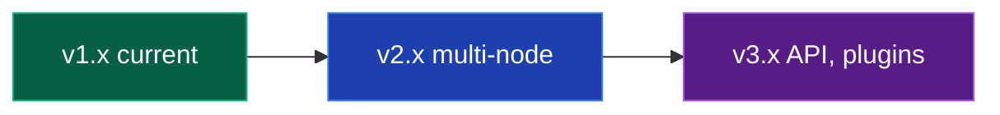
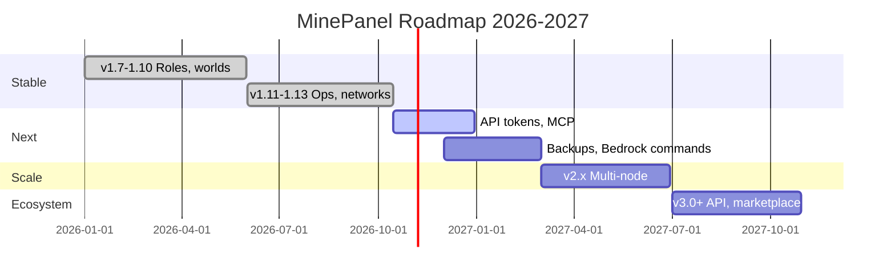

# Roadmap

What's shipped and what's planned for Minepanel. Current stable line: `v1.13.x`.

> This page tracks intent, not guarantees. Priorities shift with community
> feedback, technical constraints, and available time.

---

## Shipped

Already available in the current stable line.

### ✅ Roles & access control

- `ADMIN` and `USER` roles
- Per-user permissions: server access, logs vs console, global vs per-server files
- `manageUsers` delegated permission; `changeServerVersion` and `useGlobalFiles` can only be granted by an admin
- Invitation links with optional SMTP delivery
- Filterable audit log (logins, invitations, password/email changes, server actions, console commands)
- Single sign-on with any OpenID Connect provider, with optional password-login disable (see [SSO](/sso))

### ✅ World Library & Discover Worlds

- Per-server world source library and a shared library for all servers
- World switching from folders (`level.dat`) and archives (`.zip`, `.tar`, `.tar.gz`, `.tgz`)
- **Discover Worlds**: search CurseForge worlds and import remote ZIP/TAR URLs
- Browsable library page and a per-server **Worlds** tab
- Experimental feature packs for new Java worlds and Vanilla Tweaks datapacks by share code

### ✅ Multi-language

- 9 languages: English, Spanish, French, German, Dutch, Polish, Russian, Portuguese, Turkish

### ✅ Mods & plugins

- In-panel search and install for Modrinth and CurseForge (mods, plugins, datapacks, modpacks)
- Modrinth dependency resolution (required/optional)
- CurseForge individual files alongside Modrinth
- Mod list with pinned versions; unpinned mods track the newest compatible build
- Modpack version picker, pinned modpack file and newer-release flag
- Upload `.zip`/`.mrpack` modpacks (in chunks), with a review that strips client-only mods
- **Mod Watch** tab: notes per mod, compatibility against a target Minecraft version and changelog history
- CurseForge API key test without saving
- Fabric support (loader/launcher version config)
- Cross-play Paper template (Geyser, Floodgate, ViaVersion, UDP 19132)

### ✅ Bedrock Edition

- Full Bedrock server support and Bedrock-specific settings
- Addon Manager: upload `.mcaddon`/`.mcpack`/`.zip`, auto-extract, priority ordering, generate `world_*_packs.json`
- Browse and import addons from CurseForge

### ✅ File manager

- Integrated text editor with syntax highlighting
- Folder uploads and drag & drop
- Chunked, resumable uploads for files over 8 MB; native browser downloads for large files and folder ZIPs
- Multi-select, keyboard navigation, filter and sort
- Guided `server.properties` editor: version-aware keys, validation, change review, and timestamped backups with restore

### ✅ Dashboard & monitoring

- Status cards: status, players, uptime and CPU/RAM at a glance
- Favorites and bulk start/stop on the Servers page
- Visual alerts for high CPU/RAM
- Real-time sidebar sync
- Log viewer with search, filtering, error highlighting, live stats, export and saved presets
- Availability history (24h / 7d / 30d) with recent downtime

### ✅ Historical metrics

- Per-server TPS, tick time, CPU, memory and player samples collected every minute
- Usage graphs from 1h to 7 days (Metrics tab), with 7-day retention
- Native NeoForge tick estimates, spark measurements, and a custom tick command (e.g. TabTPS) with a live test

### ✅ Server control & commands

- Start, stop, force stop, restart, delete and clone
- Commands tab with searchable presets, suggestions and session history (Java)
- Gamerule editor with live values (Java)
- Event commands on server start, player join and player leave (Java)

### ✅ Scheduled tasks

- Auto restarts and scheduled console commands (Java RCON)
- Fixed interval or cron expression per task
- Rotating chat announcements (Java)
- Enable/disable, run-now, and per-server management (Tasks tab)

### ✅ Server creation & templates

- Quick-create wizard
- Built-in templates (Survival, Creative, SkyBlock, PvP, Bedrock presets, Paper cross-play)
- Server types: Vanilla, Paper, Forge, NeoForge, Fabric, Purpur, GTNH, CurseForge, Modrinth & Feed The Beast (FTB) modpacks
- Instance-wide Java defaults for new servers
- Simple / Advanced mode and a Ctrl/Cmd+K settings palette in the server editor
- Admin-only custom compose snippets

### ✅ Player management

- Online players, whitelist, ops, ban/kick
- Quick actions: gamemode, teleport, heal, give
- Admin actions: save, whitelist toggle, time/weather, broadcast
- Player sessions from join/leave logs, Players tab, activity log and inventory history: see [Player insights](#player-insights)

### ✅ Integrations & networking

- Notifications through Discord, email, Telegram, ntfy and Slack: see [Alerts](#alerts)
- mc-router managed by the panel: single port for many Java servers by hostname, power on/off,
  auto-scaling (sleep idle servers) with a per-server opt-out
- Velocity networks for Paper-family 1.19+ servers: lobby, fallback and `/server` switching with
  modern forwarding set up by the panel (see [Networking](/networking#velocity-network-java-only))
- Update notices with release notes, and one-click update with rollback for admins
- Panel data on bind mounts or named volumes, host paths auto-detected (see [Storage & Scaling](/storage-scaling))
- Multi-arch images (x86_64, ARM64)

---

## In progress / next (v1.14+)

Smaller, high-value items that fit the current single-node architecture.

### API tokens and MCP server (in development)

- Personal, scoped and revocable API tokens, so scripts and automations can call the panel
- An MCP endpoint so AI agents can operate the panel with exactly a token's permissions
- Details in [Public API](#public-api)

### Bedrock console commands

- Bring Bedrock into the Commands tab. Today its commands go through `send-command` from the
  Logs tab, and the output only shows in the server logs

### Backups

- One-click backup and one-click restore (see [Cloud backups](#cloud-backups))
- More flexible backup scheduling (beyond the current `backupInterval`)

---

## Phase 2: Multi-node (v2.x)

> Run servers on more than one machine from a single panel.

| Mode           | Description                         | Use case                         |
| -------------- | ----------------------------------- | -------------------------------- |
| **Standalone** | Docker Compose, single host         | Current setup, no changes needed |
| **Multi-node** | Same compose files on other daemons | Multiple VPS from one panel      |

The direction is in [Storage & Scaling](/storage-scaling#phased-roadmap):

- **Shared filesystem** (possible today): NFS/Gluster mounted at the same path on every node
- **Driver abstractions**: `NodeDriver` / `StorageDriver`, with the current local behavior as default
- **Remote Docker per server** (`DOCKER_HOST` / Docker contexts), so the compose-per-server model
  survives. Swarm `stack deploy` is not the target: it would mean rewriting compose generation
- Node management UI: connected nodes, status/resources, and server-to-node assignment

> This is the largest planned effort. It starts with a design spike, not code.

---

## Phase 3: Pro features (v2.x)

### Cloud backups

Shipped so far: restic backups to any S3-compatible destination (AWS S3, MinIO,
Backblaze B2, Wasabi) configurable from the panel, retention policies
(`PRUNE_RESTIC_RETENTION`), and snapshot listing in the backup section.

Still planned:

- One-click restore from a snapshot
- Guided setup for Google Cloud Storage and SFTP/FTP (rclone)

### Alerts

Shipped so far: per-server Discord, email, Telegram, ntfy and Slack alerts for unexpected server down, crash
loops (restart retry limit ran out, with exit code and log tail) and sustained
high CPU/RAM (configurable thresholds, sustain window and cooldown, in the
Metrics tab), plus admin-managed notification channels, lifecycle/alert switches and
saved-destination tests under Settings > Integrations. Email uses the instance SMTP settings;
Telegram/ntfy tokens and Slack webhook URLs are encrypted and write-only. Opt-in low disk space, failed backup and incident
recovery alerts also ship, with repeat intervals. Opt-in scheduled task failures, sustained
game-query failures and Java/restic overdue-backup alerts join per-channel attempt outcomes
and bounded explicit rate-limit retry.

Still planned:

- Log-error alerts
- Discord bot (see [Player insights](#player-insights)): answer `/status` and
  `/players`, and `/console` for linked admins, next to the existing webhooks

### Player insights

Shipped so far (Java, from world files, logs and RCON, no server-side plugin):

- **Players tab**: everyone who joined, with stats, advancements, inventory, ender chest and
  what carried shulkers hold; per-player actions; "who has this item" search
- **Activity log** (opt-in per server): sessions with per-session stats, weekday pattern and
  streak; searchable timeline of joins, leaves, chat, deaths, advancements and commands;
  import of archived logs
- **Inventory history**: snapshots on join, leave and autosave, with changes and the last
  snapshot before each death

Next, no plugin needed (designed, not scheduled):

- **World map**: a BlueMap render served by the panel, later live players, portals, spawn points
  and a visit heatmap. Waiting on its cost: an extra image, a Mojang EULA step for textures, and
  CPU/disk to render large worlds
- **X-ray report**: valuable ores per 1000 stone-like blocks against the server median, flagged
  as "worth a look", never as a verdict. The per-session data it needs is already recorded

Possible later, needs code inside the Minecraft server (not available, needs a design):

- **CoreProtect / Ledger reader** (first iteration): when one of those plugins is already
  installed, read its database to show block breaks/places, container transactions and kills in
  the activity timeline, and where a suspected x-ray player dug. Only works where the operator
  installed it; MySQL-backed installs and schema changes between versions need handling
- **Minepanel agent**: a small plugin/mod that sends events to the panel: block changes, PvP
  damage ("who swung first"), the exact inventory at death, positions without RCON polling.
  Costs one build per loader (Paper, Fabric, NeoForge/Forge) and version range, and an event
  volume that likely needs its own database
- **Discord bot**: a gateway bot next to the webhooks, with Discord ↔ Minepanel account linking
  and the same permission checks as the panel (`useConsole`, read-only users)

> Open design questions for the agent-based items: how the agent authenticates and sends
> events, where high-volume events are stored, and how the bot is kept from bypassing panel
> permissions.

### Network features

Velocity networks with Paper-family backends are available (see
[Networking](/networking#velocity-network-java-only)). Next possibilities:

- **More backends:** legacy forwarding for Spigot/Bukkit, Fabric/Quilt through
  FabricProxy-Lite, Forge/NeoForge through a forwarding mod, and Paper before 1.19
- **Proxy management:** plugin installs, console and logs for the proxy from the UI,
  and forwarding secret rotation
- **Scaling:** lobby pools, health-aware routing, auto-scaling, and multi-node backends
- **Other editions:** BungeeCord compatibility and Bedrock support

### Resource limits per user

- Build on the existing roles system: quotas and per-user resource caps

---

## Phase 4: Ecosystem (v3.0+)

### Public API

- 🚧 In development: token / API-key authentication for automation and third parties
  (personal, scoped to the user's permissions and servers, read-only option, expiry, revocable)
- 🚧 In development: MCP server, so AI agents (Claude, Cursor, VS Code…) can operate the panel
  with exactly the permissions of the token they use
- Reference docs and SDKs (JS, Python)
- Generic outbound webhooks (custom HTTP endpoints) next to the Discord, email, Telegram, ntfy
  and Slack notifications

### Template marketplace

- Share and import community templates and pre-configured modpacks

### MinePanel plugins

- Plugin system, community apps, panel themes

---

## Quick wins (anytime)

- Dark/Light mode toggle
- Keyboard shortcuts: shipped for the file manager, the Commands tab and the server editor
  palette (Ctrl/Cmd+K); still planned panel-wide
- ~~Favorites (frequent servers at top)~~ ✅ Shipped (star a server; stored in the browser)
- Global search (across servers, players and files; the Ctrl/Cmd+K palette covers one server's settings)
- ~~Copy server (clone configuration)~~ ✅ Shipped
- ~~Bulk actions (start/stop multiple)~~ ✅ Shipped (select servers on the Servers page, then start or stop them)
- Server groups/folders
- Reverse proxy helper (NGINX/Caddy)
- Config import/export

---

## Maybe (future consideration)

- Native mobile app (iOS/Android)
- Server performance comparison
- ~~RCON console with autocomplete~~ ✅ Shipped (Commands tab suggestions and searchable presets)

---

## Timeline

**Milestones:**

| Period      | Version     | Focus         | Key features                                                        |
| ----------- | ----------- | ------------- | ------------------------------------------------------------------- |
| Q1–Q2 2026  | v1.7–1.10   | **Stable** ✅ | Dashboard, roles & audit, World Library, multi-language, Bedrock addons, mods search |
| Q2–Q4 2026  | v1.11–1.13  | **Stable** ✅ | Scheduler & metrics history, player insights, Velocity, multi-channel alerts, Mod Watch, guided server.properties editor, SSO |
| Q4 2026     | v1.14+      | **Next**      | API tokens, MCP server, backup restore, Bedrock console commands    |
| 2027        | v2.x        | **Scale**     | Multi-node (remote Docker per server), node UI                      |
| 2027+       | v3.0+       | **Ecosystem** | Public API docs & SDKs, outbound webhooks, marketplace, plugins     |

---

## How to contribute

Want to help build these features? Check [CONTRIBUTING.md](https://github.com/Ketbome/minepanel/blob/main/CONTRIBUTING.md)

Ideas? Open an issue or discussion on GitHub.

## Stay updated

- Watch the [GitHub repo](https://github.com/Ketbome/minepanel)
- Check [releases](https://github.com/Ketbome/minepanel/releases)
- Follow updates on Docker Hub
